

  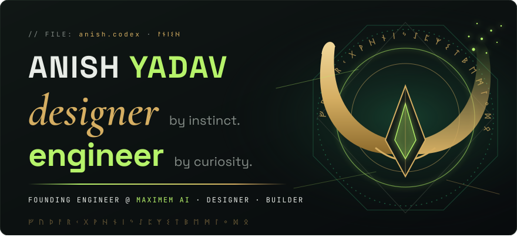 
  <a href="#now">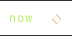</a><a href="#work">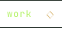</a><a href="#arsenal">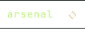</a><a href="#codex">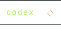</a><a href="#experiments">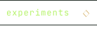</a><a href="#proof">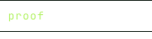</a> 
  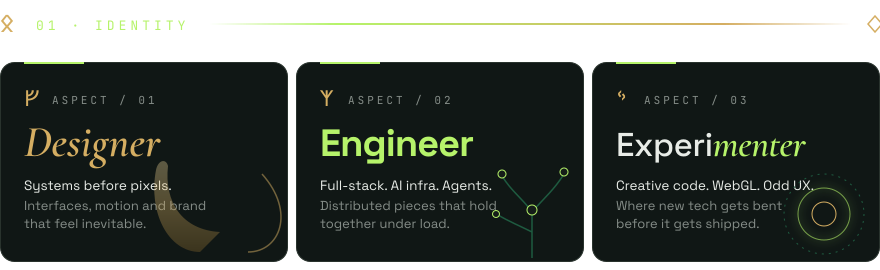 
  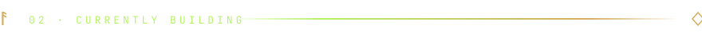 
  <a href="https://maximem.ai">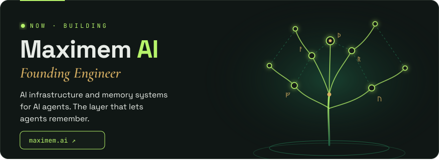</a> 
  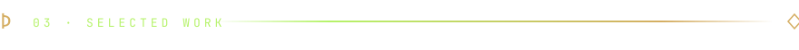 
  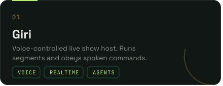<a href="https://github.com/visy-ani/incident_commander">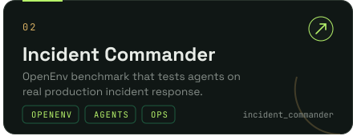</a> 
  <a href="https://github.com/visy-ani/multimodal-product-catalogue">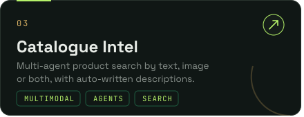</a><a href="https://github.com/visy-ani/video-editor">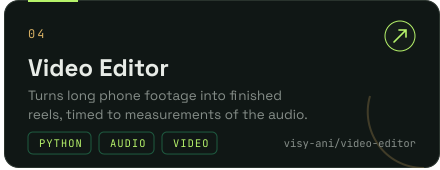</a> 
  <a href="https://github.com/visy-ani/headless-diff-server">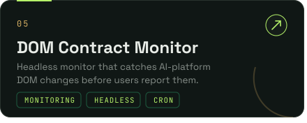</a><a href="https://github.com/visy-ani/documind-ai">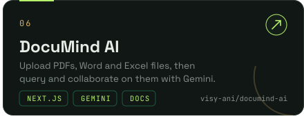</a> 
  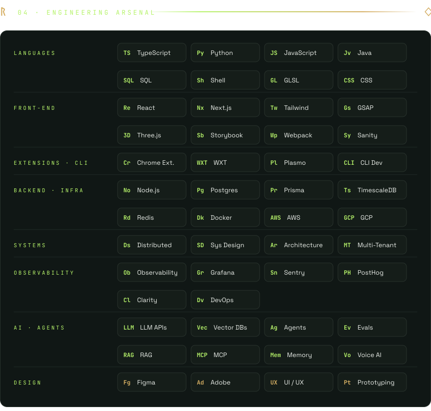 
  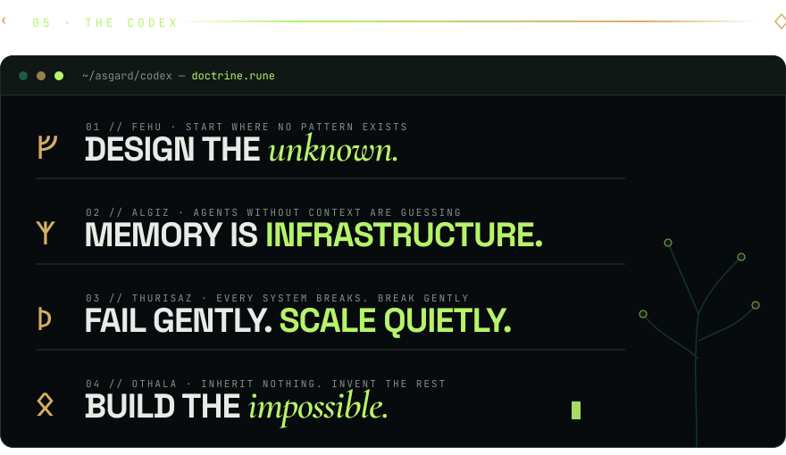 
  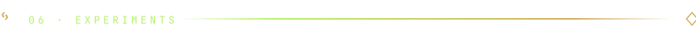 
  <a href="https://github.com/visy-ani/shader-study">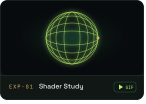</a><a href="https://github.com/visy-ani/particle-trails">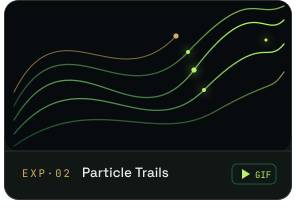</a><a href="https://github.com/visy-ani/magnetic-grid">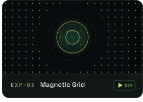</a> 
  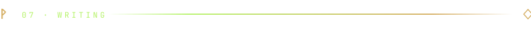 
  <a href="https://medium.com/@visy-ani/how-do-we-scale-an-ai-agent-016259077f94">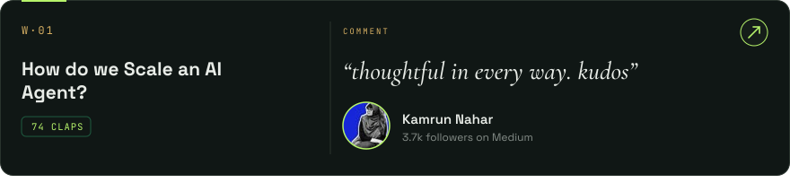</a> 
  <a href="https://medium.com/@visy-ani/how-does-an-agent-remember-e5a0891b523e">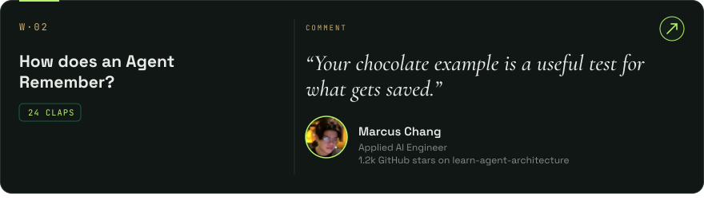</a> 
  <a href="https://medium.com/@visy-ani/what-actually-makes-an-ai-agent-dba44297da82">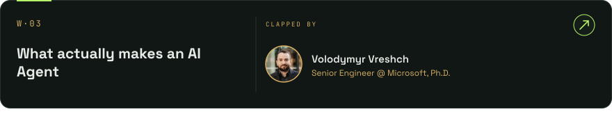</a> 
  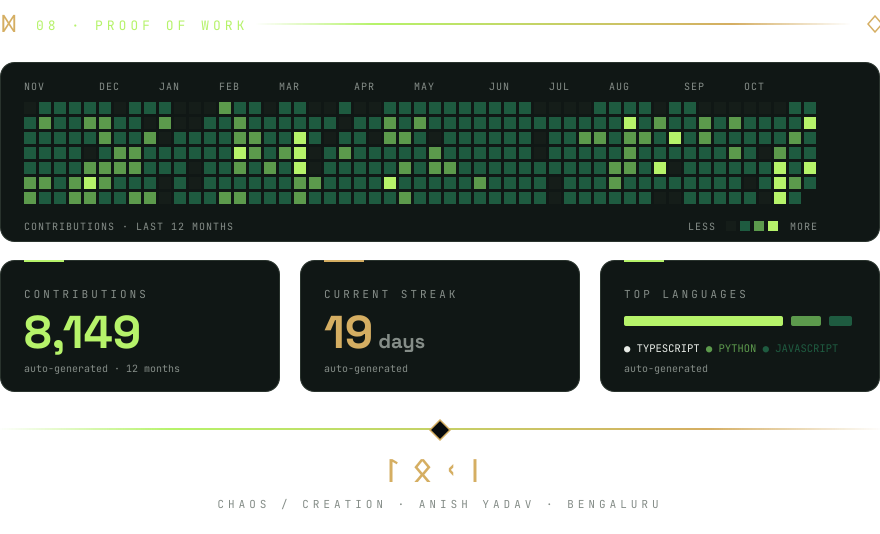 
  <a href="https://maximem.ai">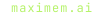</a><a href="https://www.linkedin.com/in/visy-ani/">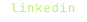</a><a href="https://dev.to/visy-ani">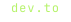</a>

